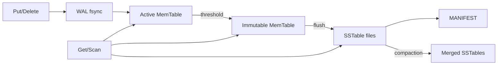

# StrataKV

StrataKV is a compact LSM-tree key-value storage engine in Java. Production databases such as RocksDB, Cassandra, and LevelDB use log-structured merge trees to trade write amplification, read amplification, and disk space. StrataKV makes those trade-offs explicit in readable code: a checksummed WAL, memtables, immutable SSTables with Bloom filters and sparse indexes, size-tiered compaction, crash recovery, and a small admin API for observability.

## Features

- Durable WAL with CRC32 per record and configurable sync (`EVERY_WRITE` or `GROUP_COMMIT`)
- Memtable backed by `ConcurrentSkipListMap` with size-based rotation
- SSTable format with data blocks, sparse index, Bloom filter, and versioned footer
- Background flush on virtual threads; WAL trimmed only after SSTable + `MANIFEST` are durable
- Read path: active memtable → immutable memtables → SSTables (newest first) with Bloom pruning
- Tombstones, overwrite semantics, and range scans via k-way merge (newest wins)
- Size-tiered compaction with atomic `MANIFEST` updates
- Crash recovery: `MANIFEST` load, WAL replay, torn-tail truncation, orphan temp cleanup
- Kill -9 harness: separate JVM writer, forcible termination, durable key verification
- Spring Boot admin module with Swagger UI
- JMH and simple benchmark runners

## Architecture



## On-disk formats

### WAL record

Each record is:

| Field | Size | Description |
|-------|------|-------------|
| `length` | 4 bytes | Payload length |
| `crc32` | 4 bytes | Checksum of payload |
| `length_dup` | 4 bytes | Duplicate length for torn-record detection |
| `payload` | variable | `type(1) + key_len(4) + key + value_len(4) + value` |

Segment files live under `wal/wal-<id>.log`.

### SSTable layout

| Region | Content |
|--------|---------|
| Data blocks | Length-prefixed entries sorted by internal key |
| Index | Sparse `(first_key_in_block, block_offset)` entries |
| Bloom filter | Serialized bit array + hash count |
| Footer (44 bytes) | `index_offset`, `index_length`, `bloom_offset`, `bloom_length`, `version`, `magic` |

Magic constant: `0x535452414B563131` (`STRAKV11`).

### MANIFEST

Text lines:

```
VERSION=<n>
NEXT_SSTABLE_ID=<n>
ACTIVE_WAL=wal-<id>.log
SSTABLE=0001.sst
```

Updates use `MANIFEST.tmp` → fsync → atomic rename.

## Write path

1. Append `PUT`/`DELETE` to the active WAL and fsync (per policy).
2. Apply to the active memtable (sequence number, tombstone flag on delete).
3. When the memtable exceeds the threshold, rotate it to immutable and schedule flush.
4. Flush writes a new SSTable, appends to `MANIFEST`, rolls WAL, deletes fully flushed segments.

## Read path

1. Search the active memtable, then immutable memtables (newest first).
2. For each SSTable (newest first), consult the Bloom filter; skip the file on a definite miss.
3. Binary search the sparse index, scan the data block, pick the latest sequence for the user key.
4. Range scans merge iterators from all levels; tombstones and superseded versions are dropped.

## Compaction

When the SSTable count reaches the configured tier threshold, similarly sized files are merged:

- K-way merge with newest-wins per user key
- Drop tombstones and overwritten values in output
- Write a new SSTable, atomically replace inputs in `MANIFEST`
- Readers keep using old files until the metadata switch

## Crash recovery

Startup (`RecoveryService`):

1. Delete orphan `*.tmp` files
2. Load `MANIFEST`
3. Open existing SSTables
4. Replay WAL segments; truncate torn tails on the active segment

### Kill -9 test

`CrashWriterMain` runs in a separate JVM, performs `put`, prints `ACK:<key>` only after WAL sync. The test feeds keys, calls `Process.destroyForcibly()`, reopens the engine, and checks every acknowledged key. CI uses 3 iterations (`CrashRecoveryTest`); `scripts/crash-test.sh` runs 20 iterations via `CrashTestRunner`.

## Admin API

Module: `stratakv-admin` (port 8080).

| Method | Path | Description |
|--------|------|-------------|
| GET | `/stats` | SSTable count/size, memtable size, Bloom FPR, write amplification, flush/compaction counters |
| POST | `/compact` | Trigger compaction |
| GET | `/kv/{key}` | Read |
| PUT | `/kv/{key}` | Write (body = value) |
| DELETE | `/kv/{key}` | Delete |

Swagger UI: `http://localhost:8080/swagger-ui.html`

```bash
mvn -pl stratakv-admin spring-boot:run
```

## Build and run

Requirements: Java 21, Maven 3.8+.

```bash
mvn verify
```

Crash stress (20 iterations):

```bash
./scripts/crash-test.sh 20
```

Benchmarks:

```bash
./scripts/run-benchmarks.sh
```

## Benchmark results

Measured on this repository’s CI VM: **4 CPUs**, **Linux 6.12**, **OpenJDK 21.0.13** (2026-10-24).

### JMH (`StrataKvBenchmarks`, 2 measurement iterations)

| Benchmark | Bloom on | Throughput |
|-----------|----------|------------|
| randomWrite | true | 8,451 ops/s |
| randomWrite | false | 8,483 ops/s |
| randomReadHit | true | 116,928 ops/s |
| randomReadHit | false | 74,391 ops/s |
| randomReadMiss | true | 237,490 ops/s |
| randomReadMiss | false | 91,733 ops/s |
| rangeScan | true | 906 ops/s |
| rangeScan | false | 1,080 ops/s |

Bloom filters reduce data-block work on hits; with `bloomFalsePositiveRate=1.0` the filter is effectively disabled (miss path still pays block index lookup).

### Simple runner (3,000 keys, after preload)

| Bloom | Writes | Reads | p50 read | p99 read |
|-------|--------|-------|----------|----------|
| on | 8,490 ops/s | 38,551 ops/s | 20 µs | 109 µs |
| off | 10,836 ops/s | 56,287 ops/s | 18 µs | 33 µs |

## Project structure

```
pom.xml                     Parent POM (Java 21)
stratakv-core/              Engine: WAL, memtable, SSTable, compaction, recovery
stratakv-admin/             Spring Boot REST + Swagger
stratakv-benchmarks/        JMH + SimpleBenchmarkRunner
scripts/                    crash-test.sh, run-benchmarks.sh
.github/workflows/ci.yml    mvn verify on push/PR
```

## Testing

```bash
mvn test
```

Core tests cover WAL integrity, memtable rotation, SSTable/Bloom behavior, flush, read semantics, compaction, recovery, and the kill -9 harness. Admin tests use MockMvc.

## What I learned

- **Write amplification**: every flush and compaction rewrites bytes already stored; tracking `bytesWritten / userBytesWritten` makes the cost visible.
- **Read amplification**: point reads may touch memtables, multiple SSTables, and entire data blocks; Bloom filters and sparse indexes reduce unnecessary I/O.
- **Space amplification**: tombstones and old versions persist until compaction reclaims them.
- **WAL durability**: `fsync` latency dominates single-threaded write throughput; group commit batches latency at a durability boundary.
- **Bloom filters**: tuning false-positive rate trades memory for read efficiency; disabling the filter (`fpr=1.0`) shows the cost of unconditional block checks.
- **Compaction**: size-tiered merging is simple to reason about but requires careful newest-wins merge ordering.
- **Crash consistency**: checksums plus duplicate length fields detect torn records; integration tests that kill a separate JVM expose fsync/recovery bugs unit tests miss.

## License

[MIT License](LICENSE). Developed by Dumidu Lakshan.